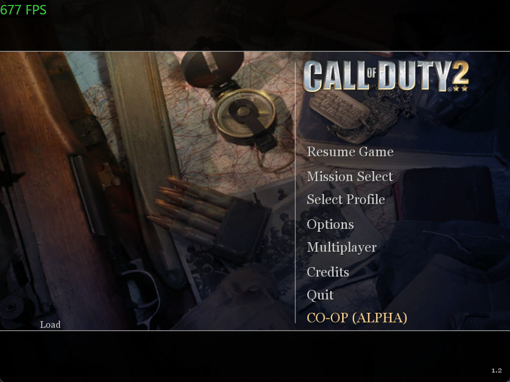

# CoD2SP-CO-OP — ALPHA 0.1.0

**COD2 CO-OP · Cooperative Campaign Modification · Developed by Heperkoo**

Native two-player campaign co-op development for **Call of Duty 2 (2005)**, starting with **Red Army Training (`moscow`)**. Windows 10/11 x64, original x86 Steam game, host-authoritative LAN, one host and one client.

**Development checkpoint, not a completed playable release.** Two real player entities and remote movement have been demonstrated inside the host's original mission. A second rendered game client, reliable visible partner presentation and end-to-end campaign synchronization have not been demonstrated.

## Implemented and tested

- x86 native runtime DLL, Steam launcher and Windows control panel built with CMake/MSVC.
- Executable/renderer hashes and native call signatures checked before engine access. Original Steam executables remain unmodified on disk.
- Native **CO-OP (ALPHA)** entry with Host, Join, Soldier and Settings tabs. These share one menu definition to avoid SP's fixed 64-menu registry limit.
- Bounded versioned UDP protocol: compatibility handshake, two-player limits, input/snapshot sequencing, reliable ordered events, timeout/reconnect and world-position pages.
- Experimental pre-map expansion of game-client/server-client storage. Native `ClientConnect(1)` / `ClientBegin(1)` create a second client-backed player with its own sentient. The canonical protagonist remains entity 0; the second has classname `coop_player`.
- Real remote movement: an independent network process moved player 2 approximately **137.66 horizontal units**, while player 1 stayed still. That capture received **96 native snapshots** and **880 world-update pages** in about five seconds. This verifies host-side movement and transport, not a second client world.
- Automated protocol/session, world-tracking and launcher UI checks; independent-process packet-loss/duplicate-delivery tests.

## Current implementation work

- **Visible Soviet partner and nametag:** body/head/helmet assignment, idle/walk/run tree, native body submission and a `j_head` nametag are implemented as experimental code. Render counters ran, but the user still could not see the partner. Visibility, placement and animation acceptance remain open.
- **Low-level diagnostics:** native entity/client observations, stack diagnostics, model/bone/camera reports and a collision-checked regroup helper exist. The newest regroup/diagnostic helpers still need launcher wiring and runtime verification.
- **Client world mirror:** `src/engine/native_client_mirror.*` contains the opt-in thin-client experiment. It is not yet wired into the main runtime target or acceptance-tested. The intended client freezes local mission authority, applies host state and controls player 2.
- **Broader synchronization:** NPC templates/spawns, animation, weapons, damage, interactions, objectives and scripted progression still need authoritative engine integration.
- **Automated missions:** a mission scenario runner is planned/in progress; the current suite does not automatically complete every campaign mission.
- **Two game windows:** a legitimate second original-SP launch exited before a second renderer/window was observed. A two-window synchronization test has not passed.

## Limitations

**Experimental two-player checkpoints are disabled.** The original writer stores only one client record. The mod declines checkpoint requests through the native nonfatal path instead of writing invalid two-player saves. Save/restore, revive and campaign transitions are unsupported.

The player-2 experiment is opt-in, fresh-Moscow and one-shot per process. Rendering submissions do not prove visible pixels. World telemetry carries observed positions; it does not establish synchronized combat or mission logic. Sampled entity tracking can miss very rapid slot reuse until complete lifecycle hooks exist.

Join stays at the game menu instead of starting an independent campaign and presenting it as shared co-op. Wi-Fi/Ethernet IPv4 LAN is supported; public Internet servers, matchmaking and Spacewar are not integrated. There is no separate mod account/login. Normal Steam authentication remains intact.

## Build and test

Requirements: Visual Studio 2022 Build Tools with x86 C++, Windows SDK and CMake 3.24+. Python 3 is needed for the optional packet-loss test. Original game files are required for launch/UI staging, not compilation.

```powershell
.\tools\build.ps1 -Configuration Debug
.\tools\build.ps1 -Configuration Release
.\tests\network\run-integration.ps1 -Configuration Release
```

CTest covers protocol/session authority, native-world tracking and native launcher controls. Executed checks included **195 network/protocol assertions** and **1,443 world-tracker assertions**; counts can change with source updates. Fixture tests, native host movement and full gameplay acceptance are separate results.

Build output: `build/verified-x86/<Configuration>/`.

## Run

Start Steam normally and close any existing SP test instance:

```powershell
.\build\verified-x86\Release\COD2CoopControl.exe
```

The launcher stages the native UI into an isolated game-home and starts original Steam App **2630**. Select **CO-OP (ALPHA)** in the game, create a session and start Moscow.

Explicit experimental player-2 launch:

```powershell
.\build\verified-x86\Release\COD2CoopLauncher.exe --launch --native-menu --experimental-player2 --attach-after-launch --host --bind 127.0.0.1 --port 28961
```

Use a reachable local adapter address for LAN. Window sizes: `--width 640 --height 480`, 800×600 or 1024×768. Unsupported executable/renderer hashes fail closed. Logs and isolated profiles/saves stay under the selected runtime directory. Experimental hooks/buffers can remain resident until the mission ends and the game exits normally. Use the isolated profile rather than an existing campaign save directory.

```powershell
.\tools\package.ps1 -Configuration Release
```

Packaging creates `dist/COD2-Coop-0.1.0-alpha/` and a ZIP containing mod binaries, own UI definitions, staging tool and this README.

## Repository scope

Tracked: independently authored source, native UI, tests, build/staging/diagnostic tools, this README and the representative main-menu capture above.

Ignored locally: `docs/`, all `analysis/` including the three research repositories, decompiler output/databases, extracted proprietary assets, captures/logs, saves, builds and packages. Private or occluded desktop captures are excluded; only the selected README image is published.

No third-party reconstruction repository or original game executable, map, texture, sound or model is bundled. Staging reads the user's installed menus and generates modified copies locally. Unofficial modification; unaffiliated with Activision or Infinity Ward.
